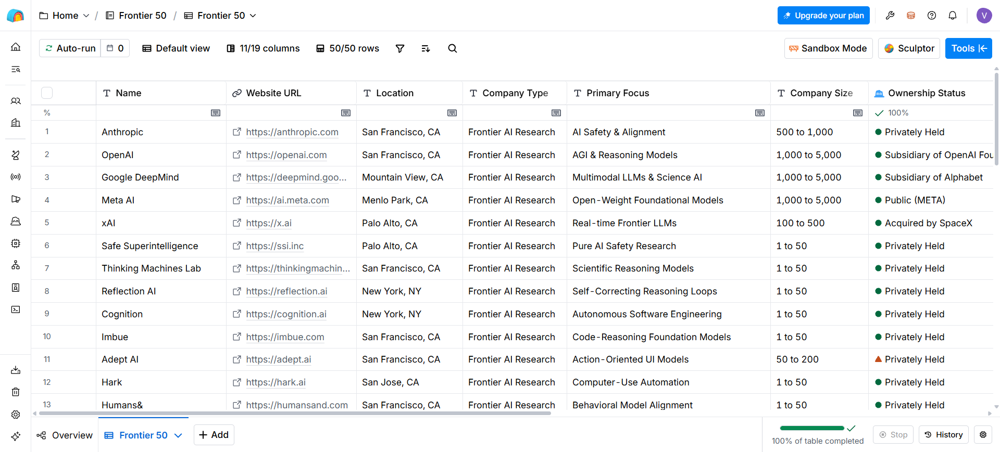
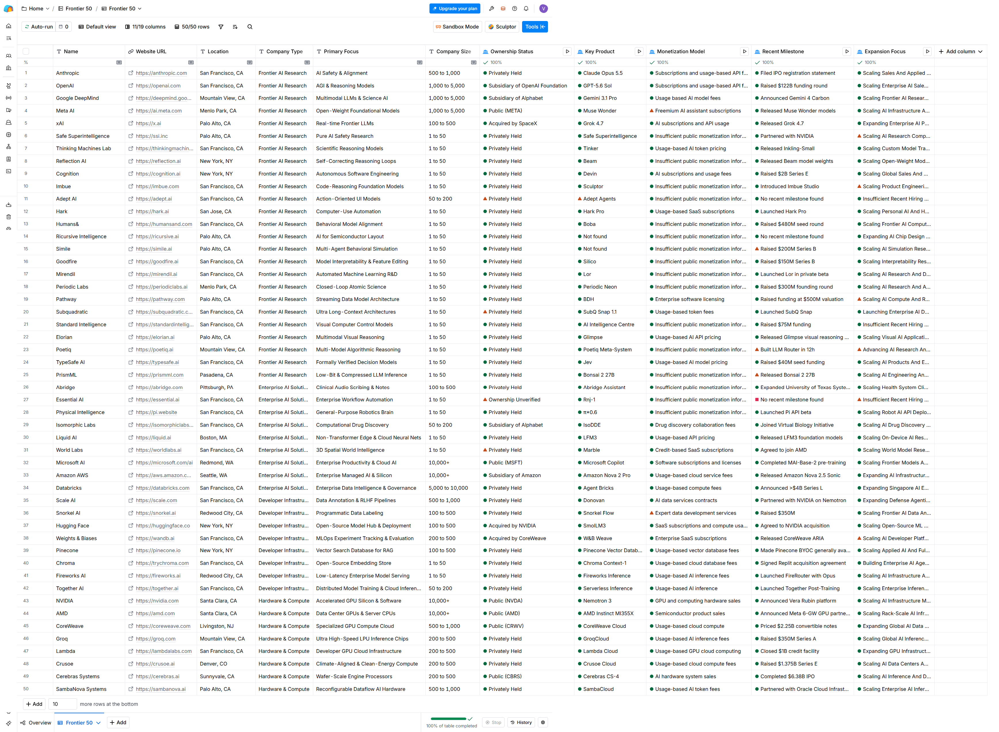

# ⛰️ Frontier 50
## 🎯 Objective  
This project is a database of 50 US-based Frontier AI companies that provides structured foundation for tracking their recent news and changes. It pairs data with AI to check every fact against official sources to an interactive workbook and exportable CSV.
## 🛠️ Tools  
Gemini, Clay 

## 🗄️ Columns  
<ul>
  <li>Name</li>
  <li>Website URL</li>
  <li>Location</li>
  <li>Company Type</li>
  <li>Primary Focus</li>
  <li>Company Size</li>
  <li>Ownership Status</li>
  <li>Key Product</li>
  <li>Monetization Model</li>
  <li>Expansion Focus</li>
</ul>

## 🖼️ Images  
<table>
  <tr>
    <td width="100%"></td>
  </tr>
</table>

<table>
  <tr>
    <td width="100%"></td>
      </tr>
</table>
